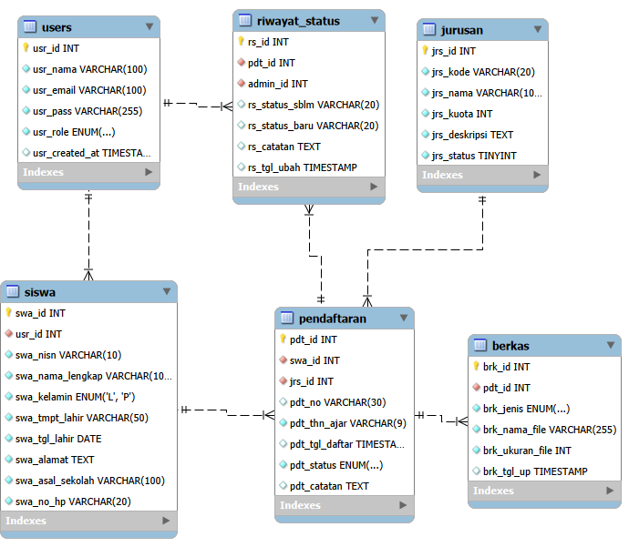
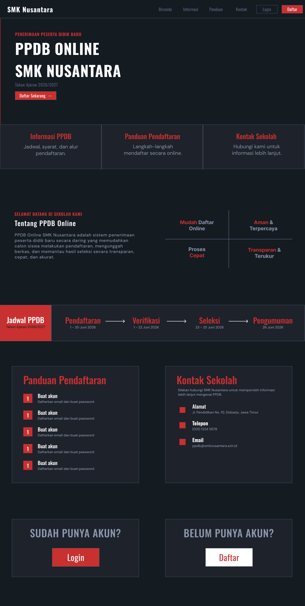
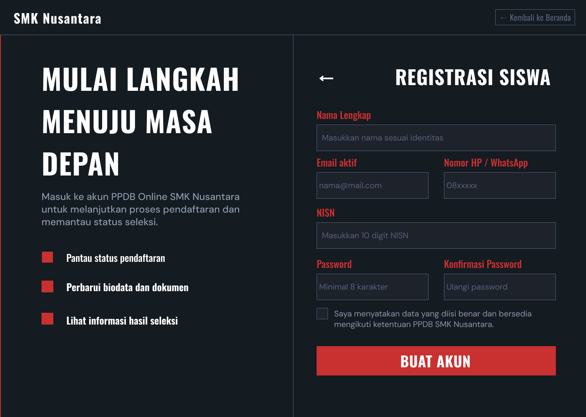

# PPDB ONLINE SMK NUSANTARA

## MINGGU 1 - Membuat Database

Yang dibuat hanyalah database, untuk saat ini belum ada data yang dimasukkan ke database kecuali data user "admin". Selain itu, satu-satunya cara melihat data di database adalah mengaksesnya secara langsung.

## Minggu 2 - Frontend dan Autentikasi

Mengimplementasikan landing, registrasi, dan login page, beserta dengan backendnya. Backend yang dimaksud hanya berupa autentikasi saja.

Waktu banyak habis untuk membuat desain UI dan mengimplemtasikannya ke HTML, CSS dan JS.

### 1. Desain UI

- Landing page
  

- Registrasi
  

### 2. Registrasi dan login

- Database configuration menggunakan PDO
- Terdapat sistem session untuk login dan logout

#### Registrasi

- NISN harus berupa 10 digit angka, antara 0-9.
- Password sudah di-hash menggunakan `password_hash()` sebelum disimpan ke database.
- Data di-insert ke dua tabel; `users` dan `siswa`.
- Isi field input tidak akan hilang jika ada error/refresh.

#### Login

- Login yang berhasil hanya akan menampilkan suatu alert pada halaman login.

### 3. Perubahahan

#### `schema.sql`

- Mengubah kolom pada table `siswa` yang tidak ada pada form registrasi, menjadi nullable.
